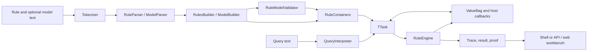
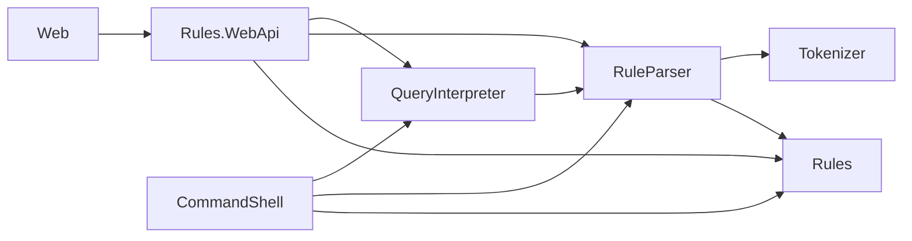
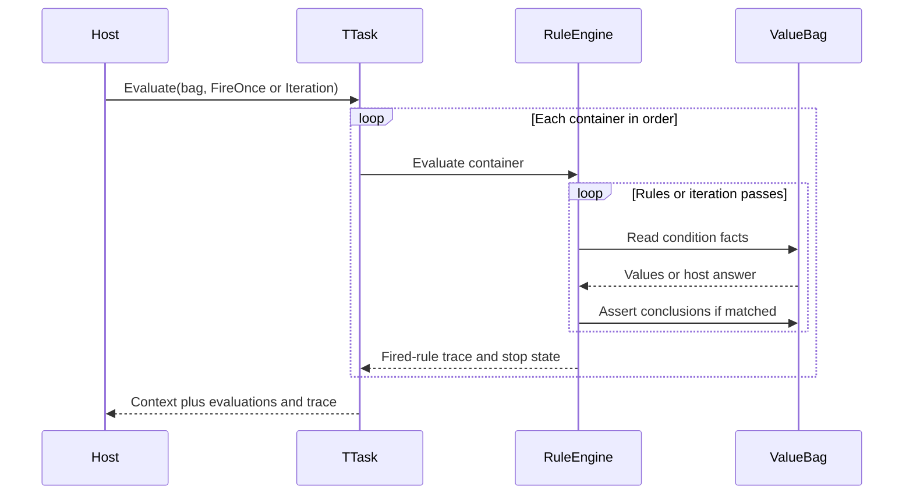
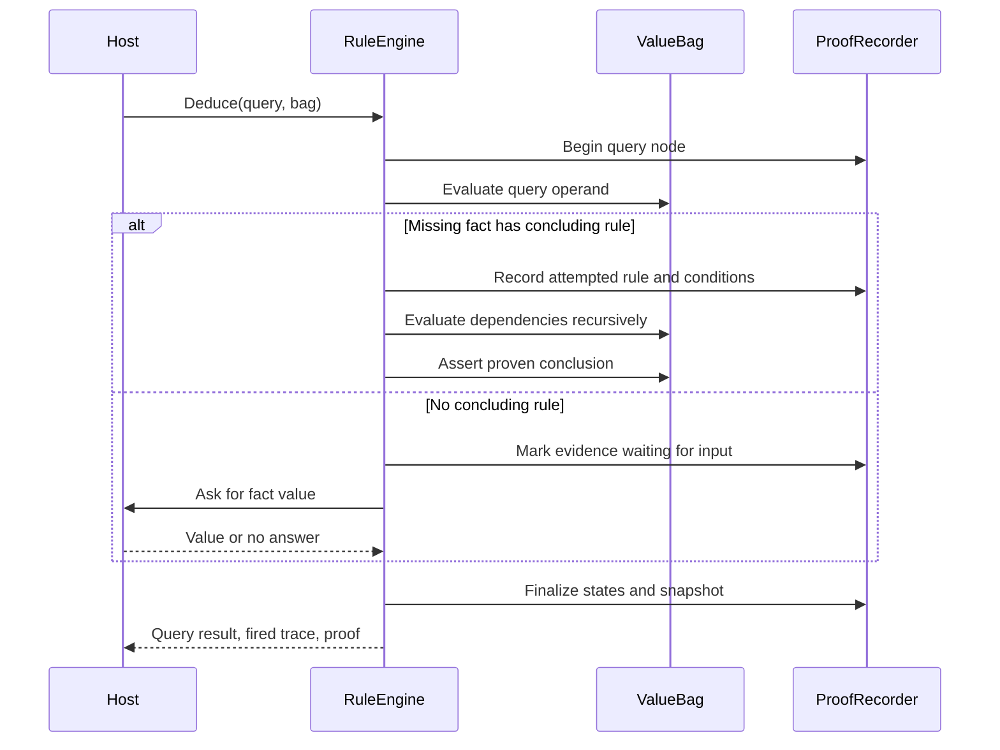

# RuleEngine architecture and developer guide

RuleEngine is an experimental, in-memory production-rule system. A host supplies rule text and facts; the system parses the text into executable expressions, evaluates rules, and returns changed facts, a fired-rule trace, and (for deduction) a proof. The active hosts are a console shell and an ASP.NET Core API used by a Vue workbench. The rule language is deliberately smaller than the object model: the host selects the evaluation mode, while rule text describes containers, conditions, and conclusions. Start with the [language reference](rule-language.md) for complete syntax.

This guide follows the runtime path a developer will debug or extend. The existing Graphify graph was consulted first to locate the parser/builder, task/engine, fact/proof, API, and UI communities and their cross-links. The behavior below was then checked in the linked source. Graph links reveal candidate relationships; they do not establish why a design was chosen. “Documented decision” below means an existing design or product document states the choice; “observed behavior” means the linked implementation performs it. Anything labeled “hypothesis” needs a product decision before it becomes a contract.

The existing [Graphify report](../graphify-out/GRAPH_REPORT.md) groups these paths among communities such as **Parser and Builder**, **Task and Deduction Workflow**, **Fact Values and Proofs**, **Runtime Service Evaluation**, and **Vue Workbench Runtime**. Its high-connectivity runtime candidates include `ValueBag`, `RuleParser`, and `TTask`; large example grammars elsewhere in the graph are corpus material, not central engine components. The graph also links the [question-to-answer diagram](Overview%20-%20from%20question%20to%20answer.png) to tokenizer, builder, task, and engine code, and the [project-dependency diagram](Project%20dependencies.png) to project references. Those diagrams describe the core path but omit the later web/API path, so the source and project files are authoritative for the current host boundary. The graph report is dated 2026-10-13; the source had not changed since it was built, so no rebuild was needed for this guide.

## The system at a glance



The **compiler boundary** is textual source to executable rule objects. The **evaluation boundary** is a `TTask.Evaluate` call with a `ValueBag`, mode, and optional parsed query. The **host boundary** resolves unknown facts and decides whether facts survive into another run. These boundaries are visible in [RuleParser.cs](../RuleParser/RuleParser.cs), [RulesBuilder.cs](../RuleParser/RulesBuilder.cs), [Task.cs](../Rules/Tasks/Task.cs), [RuleEngine.cs](../Rules/Rules/RuleEngine.cs), and [MessageSink.cs](../Rules/MessageSink.cs).

The [strategic and task-level note](Strategic%20and%20task%20level.txt) describes a future vision with an optional strategy layer organizing multiple tasks, each assigned rule containers. The current runtime has no such strategy layer or list of separate problem-solving tasks. `TTask` coordinates containers within one evaluation. Dynamic task creation, insertion, and reordering of tasks and containers belong to that future vision. Fire once, Iteration, and Deduction are current evaluation modes; calling them inference strategies does not imply support for the planned strategy layer. See [Current execution and future strategy/task levels](architecture.md#current-execution-and-future-strategytask-levels).

### Project map and dependency direction

| Area | Responsibility | Principal source |
| --- | --- | --- |
| `Tokenizer` | Lexical tokens, keywords, comments, identifiers, literals, operators | [Tokenizer.cs](../Tokenizer/Tokenizer.cs) |
| `RuleParser` | Rule/model grammar, parse-tree events, builders, explicit-model validation | [Parser.cs](../RuleParser/Parser.cs), [RuleParser.cs](../RuleParser/RuleParser.cs), [ModelParser.cs](../RuleParser/ModelParser.cs) |
| `Rules` | Fact values, expressions, containers, inference, trace, proof | [ValueBag.cs](../Rules/Model/ValueBag.cs), [RuleEngine.cs](../Rules/Rules/RuleEngine.cs) |
| `Interpreter/QueryInterpreter` | Parses a query as a rule-language condition | [Interpreter.cs](../Interpreter/QueryInterpreter/Interpreter.cs) |
| `CommandShell` | Stateful console host, file loading, prompts and explanations | [Program.cs](../CommandShell/Program.cs) |
| `Rules.WebApi` | Stateless parse/evaluate/calculate operations and interactive WebSocket transport | [Program.cs](../Rules.WebApi/Program.cs), [RuleRuntimeService.cs](../Rules.WebApi/RuleRuntimeService.cs), [InteractiveEvaluation.cs](../Rules.WebApi/InteractiveEvaluation.cs) |
| `Rules.WebApi.GUI` | Vue editor, browser-held facts, prompts, trace and proof presentation | [App.vue](../Rules.WebApi.GUI/src/App.vue), [runtime.js](../Rules.WebApi.GUI/src/runtime.js) |

`RuleParser` references `Tokenizer` and `Rules`; `QueryInterpreter` references `RuleParser`; the shell and API depend on these libraries. The parser uses the .NET `Stack<T>` with local helpers for indexed peeking and top replacement. All referenced projects are included in this repository. `Rules.WebApi.GUI` reaches the engine only through the API. This is the dependency structure in the project files and [Rules.sln](../Rules.sln). The active query interpreter project is `Interpreter/QueryInterpreter/QueryInterpreter.csproj`; its parent `Interpreter` directory is only a folder. Tests are split among `TokenizerTest`, `RuleParserTest`, and `RuleTest`, with additional web tests in [Rules.WebApi.GUI/package.json](../Rules.WebApi.GUI/package.json).



## From source text to executable rules

The tokenizer recognizes a small set of token kinds; the rule parser registers its keywords, so keywords are case-insensitive while fact names retain their spelling. A rule file can begin with one `enforce model "filename"` directive, followed by containers. `RuleParser` can also parse just a condition, conclusion, rule, or expression. It emits structured `ParseTree` start/add/end events and syntax errors. `RulesBuilder` subscribes to those events and builds `RuleContainer`, `Rule`, condition, conclusion, and expression objects; the parse-tree string is primarily diagnostic output, not an intermediate file consumed by the engine. See [Tokenizer.cs](../Tokenizer/Tokenizer.cs), [ParseTree.cs](../RuleParser/ParseTree.cs), [Parser.cs](../RuleParser/Parser.cs), and [RulesBuilder.cs](../RuleParser/RulesBuilder.cs).

For example, a bare conclusion asserts a Boolean fact, whereas `:=` assigns an expression value:

```text
RuleContainer Access
Rule allow.admin
Priority 1
If User.Role = "admin" and not User.Is.Suspended
Then Access.Is.Allowed
```

`and` joins conditions and conclusions; `or` is not in the active grammar. Arithmetic and comparison expressions are evaluated from built objects, not interpreted from text each time a rule fires. [Rule.cs](../Rules/Rules/Rule.cs) checks conditions and asserts conclusions against the current context; [RuleParser.cs](../RuleParser/RuleParser.cs) defines the accepted grammar. Fact identifiers are case-sensitive in the context even though keywords are not. See [ValueBag.cs](../Rules/Model/ValueBag.cs) and the [language reference](rule-language.md).

### Two model paths

Without `enforce model`, [DerivedModelTypes.cs](../Rules/Model/DerivedModelTypes.cs) inspects conditions and conclusions to infer coarse scalar kinds and known string literals. Related identifiers can share a derived domain. `DerivedModelDeriver` in [DerivedModelClasses.cs](../Rules/Model/DerivedModelClasses.cs) turns dotted names into a tree for the UI; it does not turn the flat fact dictionary into nested runtime objects. This path supports prompt suggestions and rejects conflicting inferred kinds, but it is not a declared schema.

With `enforce model`, the host must provide text and a filename matching the directive. [ModelParser.cs](../RuleParser/ModelParser.cs) and [ModelBuilder.cs](../RuleParser/ModelBuilder.cs) compile units, types, classes, and properties into [ExplicitModel.cs](../Rules/Model/ExplicitModel.cs). [RuleModelValidator.cs](../RuleParser/RuleModelValidator.cs) checks rule IDs, expression kinds, units, literal values, and bounds against that model before evaluation. The API also validates answers to unknown-value prompts against the resolved property type. The model grammar requires unit and type declarations before class declarations. The [types and units](../RuleParser/doc/Further%20design/Types%20and%20units.md) and [classes](../RuleParser/doc/Further%20design/Classes.md) notes are labeled proposed syntax; their described core forms are implemented, while their “further design” questions are not promises of runtime support. Unit labels do not imply conversion, and static validation cannot guarantee every computed result remains within a declared range.

The API's [ParseContainers path](../Rules.WebApi/RuleRuntimeService.cs) performs the full sequence on each parse/evaluate call: parse rules, enforce the model if requested, otherwise derive prompt metadata, then return executable containers. A mismatch or validation problem becomes a syntax error. The shell resolves the referenced model file relative to the rule file it loads in [Program.cs](../CommandShell/Program.cs).

## Fact and evaluation semantics

`ValueBag` is a flat, mutable map from identifier strings to Boolean, integer, real, or string constant values. It also owns a `MessageSink` for missing-fact callbacks and an optional proof recorder. A dotted ID such as `Customer.Age` is a single key, even when a model or UI displays it as a path. `TId` reads that key and invokes `NotifyUnknownValue` when absent; a supplied answer is added to the bag. The callback belongs to the bag, and the engine temporarily replaces it with its derivation callback using a disposable scope. This is the runtime link between expression evaluation, backward inference, and host input. See [TExpression.cs](../Rules/Expression/TExpression.cs), [ValueBag.cs](../Rules/Model/ValueBag.cs), and [MessageSink.cs](../Rules/MessageSink.cs).

The mode is chosen **per call** through `TTask.Evaluate(context, evaluationType, query)`. Both task and container evaluation require an explicit mode argument. [Task.cs](../Rules/Tasks/Task.cs) coordinates containers; [RuleContainer.cs](../Rules/Rules/RuleContainer.cs) selects an engine for one container. The modes have materially different ordering and result semantics:

| Mode | What actually happens | Ordering and stopping |
| --- | --- | --- |
| Fire once | Each rule is visited once, with current facts; a matching rule asserts its conclusions. | The engine sorts the container's rules by ascending priority. A fired rule's programmatic `Stop` can end that container. |
| Iteration | Revisit rules that have not fired until a full pass fires none. Fired rules are skipped for the rest of this call. | Traverses stored container order, without the fire-once priority sort. A fact change never reactivates an already fired rule in the same call. |
| Deduction | Evaluate one query and derive an unknown identifier by trying rules whose conclusions assign it; evaluate their conditions recursively. | Candidate rules are tried in rule order until one proves the value. With multiple containers, `TTask` borrows their rules into one temporary container and remembers each rule's origin. |

For forward modes, containers run in stored order on the same `ValueBag`; a validated container stop condition can skip later containers, but only after that container fired a rule. Deduction uses a single combined query rather than querying every container. Rule `Stop`, weights, container stop conditions, and descriptions exist in the object model, but the [active syntax](rule-language.md#features-present-in-the-object-model-but-not-in-active-syntax) does not reliably configure them; do not put them in a rule file expecting them to work. These statements are observed in [RuleEngine.cs](../Rules/Rules/RuleEngine.cs) and [Task.cs](../Rules/Tasks/Task.cs), and the syntax gap is documented in the language reference.

### Forward execution example



The `TaskEvaluateResults.Evaluations` list includes visited containers even when none fired; `TaskTrace` contains only containers with fired rules. Consequently, the API's `rounds` is a count of traced container evaluations, **not** an iteration-pass count. In combined deduction it is one if any rule fired, zero otherwise. See [Task.cs](../Rules/Tasks/Task.cs) and the response conversion in [RuleRuntimeService.cs](../Rules.WebApi/RuleRuntimeService.cs).

### Deduction, unknown facts, and explanation

`QueryInterpreter` parses query text as a condition using `RuleParser(RulePart.Condition)`; it is not a natural-language interpreter. Deduction starts evaluating that expression. If a fact is missing, the engine searches for rules concluding the requested ID. It tries a candidate's conditions and, if they succeed, asserts its conclusions. If no rule concludes the ID, it asks the host through `GetUserInput`. A supplied fact can itself unlock another derivation. Source: [Interpreter.cs](../Interpreter/QueryInterpreter/Interpreter.cs), [RuleEngine.cs](../Rules/Rules/RuleEngine.cs), [TExpression.cs](../Rules/Expression/TExpression.cs).



The [proof recorder](../Rules/Rules/DeductionProof.cs) captures query, goal, rule, condition, operand, conclusion, and evidence nodes while evaluation runs. The transport [ProofSnapshot.cs](../Rules.WebApi/ProofSnapshot.cs) converts that tree to scalar JSON with local node IDs and `evidenceId` references. A prompt snapshot exposes an `activeNodeId` pointing at the waiting fact; the final snapshot is immutable. The legacy flat trace records fired rules; the proof also retains failed alternatives and skipped conditions, including when no rule fired. A Boolean `false` fact is evidence, whereas an unresolved fact is `Unknown`. The core's historical policy can report `false` for an unestablished *root* query; do not equate that result with a complete disproof. The exact JSON contract is in [Deduction snapshots in the API](api-proof-snapshots.md), and the browser renders both a tree and a story in [proof.js](../Rules.WebApi.GUI/src/proof.js) and [proofStory.js](../Rules.WebApi.GUI/src/proofStory.js).

## Host and transport contracts

The shell keeps loaded rules and a fact context for its session. `lr` loads a rule file and selects a mode; `er` evaluates it; `calc` evaluates an expression; `how`/`why` and `rt` expose explanation and trace. This persistence belongs to the shell host, not to a global engine instance. See [CommandShell/Program.cs](../CommandShell/Program.cs) and [README.md](../README.md).

The API constructs parsed rules and a fresh `ValueBag` from each request's JSON `context`. It does not keep a server-side fact session. The browser stores the returned context and submits it on the next run; “Start fresh” clears that browser state. The scoped service lifetime in [Program.cs](../Rules.WebApi/Program.cs), construction in [RuleRuntimeService.cs](../Rules.WebApi/RuleRuntimeService.cs), and browser state in [App.vue](../Rules.WebApi.GUI/src/App.vue) establish this boundary. Context values accepted by the API are JSON Boolean, number, or string values; arrays, objects, and null are not facts.

| Interface | Request / response role | Key contract |
| --- | --- | --- |
| `GET /api/health` | Availability | Returns service status. |
| `POST /api/rules/parse` | Parse and summarize rules | Accepts `source`, optional `modelSource` and `modelFileName`; returns containers, parse tree, and derived model metadata when no explicit model is enforced. |
| `POST /api/rules/evaluate` | Noninteractive evaluation | Accepts `source`, `mode`, optional `query`, `context`, and model fields; returns `queryResult`, `trace`, `rounds`, `context`, `proofs`. Deduction requires a query. |
| `POST /api/rules/calculate` | One expression against supplied facts | Accepts `expression`, optional `context`, rule `source`, and model fields; returns `value` and `context`. |
| `WS /api/rules/interactive/evaluate` and `/calculate` | Same operations with live prompts | Client sends one request object; server sends `unknownValue` with `name`, `choices`, optional `inputType`, and `why`; client answers `{ "type": "answer", "value": ... }`; server sends `result` or `error`. |

An unanswered required fact produces `missingFacts`; evaluation errors can include a partial `proofs` array. The WebSocket handler retains the synchronous engine stack while it waits for a browser answer, and bounds the conversation to 15 minutes. The current development API allows any CORS origin; deployment policy must be supplied by the embedding environment. See [Program.cs](../Rules.WebApi/Program.cs), [InteractiveEvaluation.cs](../Rules.WebApi/InteractiveEvaluation.cs), and [RuleRuntimeService.cs](../Rules.WebApi/RuleRuntimeService.cs). The Vite server proxies `/api`, including WebSocket upgrades, to the local API in [vite.config.js](../Rules.WebApi.GUI/vite.config.js); [runtime.js](../Rules.WebApi.GUI/src/runtime.js) uses HTTP for parse and WebSockets for interactive evaluation/calculation.

### What persists, and what is isolated

- One evaluation shares facts across its forward containers; one deduction can search rules across all containers.
- API calls reconstruct rules and facts for each request. Browser-held JSON facts, not API memory, connect runs.
- `ValueBag`, callbacks, engines, and rule collections are mutable and are not intended for concurrent sharing. An interactive socket owns its evaluation and answer channel.
- A proof snapshot belongs to one deduction evaluation. Its node IDs are stable through that evaluation's prompt and final snapshots, not across runs. No proof history is stored centrally.

These are documented session decisions in [architecture.md](architecture.md) and [api-proof-snapshots.md](api-proof-snapshots.md), and the linked API and engine code implements the described lifetimes. They explain why an integration should create a context per user/session and pass the selected mode explicitly.

## Design choices, gaps, and extension points

The parse-tree event builder separates grammar recognition from constructing executable objects, which is a separation of concerns into isolated code. See `RuleParser`, `ParseTree`, and `RulesBuilder`. When changing syntax, inspect tokenizer recognition, parser events, builder handling, language documentation, and parser tests together. When changing model syntax, update `ModelParser`, `ModelBuilder`, `ExplicitModel`, and `RuleModelValidator` as one path.

Mode selection per call, request-owned contexts, and prompt-time proof snapshots are **documented decisions** in [architecture.md](architecture.md), [rule-language.md](rule-language.md), and [api-proof-snapshots.md](api-proof-snapshots.md), and are verified by source. A new inference strategy must be wired through `EvaluationType`, `RuleContainer`/`TTask`, the API mode parser, and the shell/UI choice. A new proof field must be added to the core recorder, transport snapshot, and browser renderers; the fired-rule trace alone cannot explain failed deduction paths.

Current limits that matter when extending the system:

- The active rule grammar supports conjunction but no `or`; its model-facing object types expose more concepts than rule files can configure. See [RuleParser.cs](../RuleParser/RuleParser.cs) and [rule-language.md](rule-language.md).
- Iteration fires each rule at most once per call; it is a fixed-point attempt over *unfired* rules, not general truth maintenance. Conflicting assignments can depend on rule order. See [RuleEngine.cs](../Rules/Rules/RuleEngine.cs).
- Deduction follows candidate conclusion rules recursively but has no general cycle detection. A cyclic rule set may fail to terminate cleanly; test any new recursive inference behavior explicitly. See [RuleEngine.cs](../Rules/Rules/RuleEngine.cs) and [architecture.md](architecture.md#current-constraints).
- Explicit models constrain references and input values, but model notes leave unit conversion and some richer type semantics open. Do not infer them from a `unit` declaration. See [types and units notes](../RuleParser/doc/Further%20design/Types%20and%20units.md) and [RuleModelValidator.cs](../RuleParser/RuleModelValidator.cs).
- The repo is experimental; its [architecture notes](architecture.md#current-constraints) record parser/deduction assertion failures in an earlier test baseline. Treat a new test failure as evidence to inspect, not as proof that the intended behavior changed.

## First day in the codebase

1. Install the .NET 10 SDK selected by [global.json](../global.json). All referenced projects are included in this repository. Install Node.js and npm for the Vue workbench; its interactive test script calls for Node.js 22 or newer.
2. From the repository root, run `dotnet restore Rules.sln`, `dotnet build Rules.sln`, and `dotnet test Rules.sln`. The source test projects cover tokenizer, parser/builder, and runtime behavior. The web scripts in [package.json](../Rules.WebApi.GUI/package.json) include `npm run test:ui`, `npm run test:shell`, and `npm run test:interactive`.
3. To work in the browser, start `dotnet run --project Rules.WebApi/Rules.WebApi.csproj --urls http://localhost:5215` in one terminal. In another, run `cd Rules.WebApi.GUI`, `npm install`, and `npm run dev`. Vite prints its browser URL and proxies `/api` to port 5215. For a console-only path, run `dotnet run --project CommandShell`; use `help`, then `lr`, `er`, `rt`, and `calc`.
4. Read one rule in [the examples directory](../RuleParser/doc/Examples), follow its parse through `RuleParser` → `RulesBuilder`, then place a breakpoint in `TTask.Evaluate` and the chosen `RuleEngine` method. For a missing fact, follow `TId` → `MessageSink` → `RuleEngine.DeriveValue` → host prompt. For the web path, continue through `RuleRuntimeService.Evaluate` → `InteractiveEvaluation.HandleAsync` → `Rules.WebApi.GUI/src/runtime.js`.

A compact API smoke example, after starting the API:

```powershell
$body = @{
  source = 'RuleContainer Access Rule allow.admin If User.Role = "admin" Then Access.Is.Allowed'
  mode = 'deduction'
  query = 'Access.Is.Allowed'
  context = @{ 'User.Role' = 'admin' }
} | ConvertTo-Json -Depth 5
Invoke-RestMethod -Uri http://localhost:5215/api/rules/evaluate -Method Post -ContentType 'application/json' -Body $body
```

Expect a true `queryResult`, a fact `Access.Is.Allowed` in `context`, and a deduction proof. To inspect the missing-value path, remove `User.Role` from `context` and use the interactive WebSocket workbench; the noninteractive HTTP call returns a missing-fact error instead of asking a question. The [workbench guide](../Rules.WebApi.GUI/README.md) covers the UI and development proxy; the [API proof contract](api-proof-snapshots.md) covers explanation payloads.
