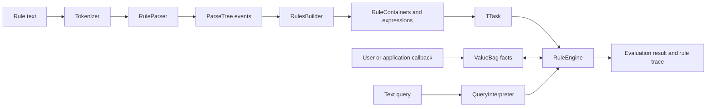
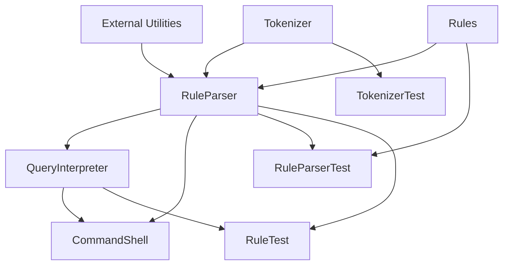

# Architecture

## Overview

RuleEngine separates the processing of a rule file into lexical analysis, parsing, object construction, and evaluation.

The implementation is synchronous and in-memory. There is no persistence layer, dependency-injection setup, service host, or external rules store.

## Solution projects

### `Tokenizer`

Namespace: `Lexical`

`Tokenizer` reads an input string and emits `Token` values with their literals. It recognizes:

- dotted identifiers such as `Customer.Address.Country`;
- integers, decimal numbers, and decimal exponent notation;
- quoted strings;
- comparison and assignment operators;
- arithmetic operators and parentheses;
- the logical words `and` and `not`;
- parser-supplied keywords;
- `//` line comments and `/* ... */` block comments.

The parser uses one-token lookahead through `GetLookAhead()`.

### `RuleParser`

Namespace: `Rules.Parser`

`RuleParser` is a hand-written, left-associative recursive-descent parser. It can be created for a complete rule container or for an isolated rule, condition, conclusion, or expression through the `RulePart` enum.

Parsing produces two outputs at the same time:

1. `ParseTree` emits a textual representation useful for diagnostics and tests.
2. `RulesBuilder` listens to parse-tree events and builds the executable object graph.

Syntax errors are collected as `(message, parseTree)` tuples. The parser attempts to recover and stops after too many errors.

### `Rules`

This is the domain and runtime library.

Its main concepts are:

| Type | Responsibility |
| --- | --- |
| `ValueBag` | Stores named `TConstantValue` facts for one evaluation context. |
| `TExpression`, `TTerm`, `TFactor` | Represent and evaluate arithmetic expressions with normal precedence. |
| `TCompareExpression` | Compares two expressions or evaluates one Boolean expression. |
| `TAssignExpression` | Writes a calculated or Boolean fact into a `ValueBag`. |
| `Rule` | Holds conditions, conclusions, priority, weight, and a stop flag. |
| `RuleContainer` | Groups rules and selects an `EvaluationType`. |
| `RuleEngine` | Evaluates one container using fire-once, iteration, or deduction. |
| `TTask` | Evaluates multiple containers sequentially and aggregates their traces. |
| `RuleEvaluateResult` | Reports fired rules, deduction status, and stop status. |

The `T` prefix distinguishes this expression model from LINQ expression types and, for `TTask`, from `System.Threading.Tasks.Task`.

### `Interpreter/QueryInterpreter`

Namespace: `Rules.QueryInterpreter`

The current query interpreter is intentionally small. It sends the supplied query to `RuleParser` as a `RulePart.Condition` and returns either a `TCompareExpression` or the parser's syntax errors. It does not perform natural-language interpretation.

### `CommandShell`

The console application wires the components together:

1. It loads a text file.
2. `RuleParser` creates `RuleContainers`.
3. The user selects or overrides the evaluation strategy.
4. A shared `ValueBag` keeps facts between commands.
5. `TTask` executes the containers.
6. The shell prints results and traces.

When a rule needs an unknown fact, the shell prompts for a Boolean, integer, double, or string value.

### Tests

- `TokenizerTest` covers token recognition and lookahead behavior.
- `RuleParserTest` covers expressions, conditions, conclusions, rules, and containers.
- `RuleTest` covers expression evaluation and rule-engine deduction.

## Runtime model

### Facts and values

`ValueBag` is a dictionary from identifier names to `TConstantValue`. Supported concrete values are numeric/Boolean (`TConstantNumValue`) and string (`TConstantStringValue`). Assigning a conclusion updates the bag; reading an absent identifier delegates value resolution through `MessageSink.NotifyUnknownValue`.

A bare conclusion such as `Access.Allowed` stores Boolean `true`. An assignment such as `Price.Total := Price.Base * 1.21` evaluates the right-hand expression and stores its result.

### Unknown-value resolution

`MessageSink` exposes two static delegates:

- `NotifyUnknownValue` is called by `TId.Evaluate` when a fact is absent.
- `GetUserInput` is the fallback used by the rule engine and command shell.

For fire-once and iteration, an unknown value is requested from the application. During deduction, the engine first searches for rules whose conclusions assign the requested identifier. It asks the application only when no matching rule exists.

### Evaluation strategies

#### Fire once

Rules are sorted by ascending priority and visited once. A rule fires when every condition evaluates to true, after which all its conclusions are asserted into the context. A rule's `Stop` flag can stop the current container.

This mode is order-sensitive: an earlier rule can create a fact consumed by a later rule.

#### Iteration

The engine repeatedly visits all rules until a pass fires no rules. This is intended as forward chaining where rule order should matter less.

The current implementation does not track whether a conclusion changed the context. Consequently, a rule whose condition remains true can keep reporting that it fired, preventing termination. Treat this mode as experimental until a stable change-detection or activation mechanism is added.

#### Deduction

The engine starts by evaluating a query. When it encounters an unknown identifier, it searches backwards for rules that conclude that identifier, evaluates their conditions recursively, and asserts the first proven conclusion. The result is:

- `true` when the query is proven;
- `false` when the root query is determined to be false or cannot be derived by the current implementation;
- `null` when an intermediate value cannot be determined.

`RuleEvaluateResult.RuleTrace` records the rules used to reach conclusions.

### Multiple containers

`TTask` evaluates `RuleContainer` instances in their stored order using a shared context. A validated container stop condition can prevent later containers from running. In the current parser, evaluation types and container stop conditions are configured by the host rather than by rule-file syntax.

## Project dependencies

`Rules.sln` references `..\Utilities\Utilities.csproj`, so the solution is not currently self-contained. The older `Interpreter` project is present in the repository but is not a solution project.

## Current constraints

- Conditions support conjunction (`and`) only; there is no `or` operator.
- The rule language does not declare an evaluation strategy. The command shell or embedding application sets it.
- The model has `Stop`, weight, description, and container stop concepts, but the active parser does not fully populate all of them.
- `MessageSink` uses mutable global delegates. Concurrent evaluations can overwrite callbacks and are not isolated.
- `ValueBag` and rule collections are not thread-safe.
- Identifier lookup in `ValueBag` is case-sensitive even though keyword tokenization is case-insensitive.
- Numeric parsing and formatting depend partly on the process culture, while the tokenizer recognizes a dot as the decimal separator.
- Iteration can fail to terminate when an always-true rule continues to fire.
- Deduction is a first implementation: it follows the first provable rule path and does not build a complete proof tree or detect every cycle.
- Equality is overridden on several domain types without corresponding `GetHashCode` implementations.
- Formatter-based exception serialization triggers a .NET 10 obsolescence warning.
- The current test baseline has nine deterministic parser/deduction assertion failures when representative failures are run in isolation. Running the entire suite can additionally expose shared static test-state contention.

## Legacy and experimental areas

- `Interpreter/Interpreter.csproj` is an older project alongside the active `Interpreter/QueryInterpreter` project. It is not in the solution and currently has recursive source-inclusion and missing-reference problems when built independently.
- Documents in `doc` and `RuleParser/doc` capture earlier design ideas. The Markdown documentation describes behavior verified against the current source.
