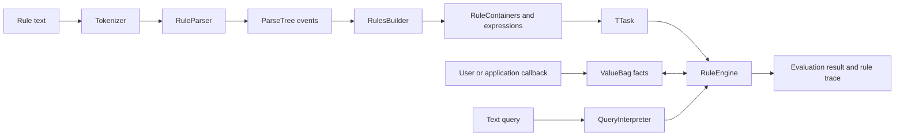
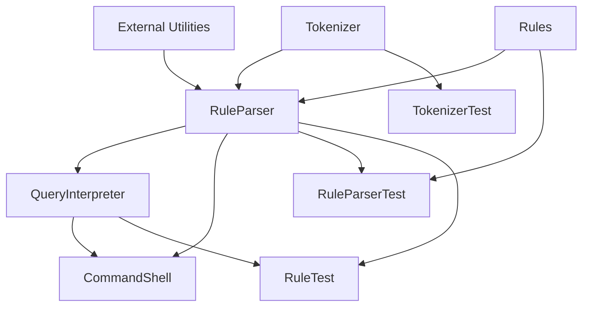

# Architecture

## Overview

RuleEngine separates the processing of a rule file into lexical analysis, parsing, object construction, and evaluation.

The core implementation is synchronous and in-memory. The web API supplies an ASP.NET Core host and dependency injection; there is no persistence layer or external rules store.

## Solution projects

### `Tokenizer`

Namespace: `Lexical`

`Tokenizer` reads an input string and emits `Token` values with their literals. It recognizes:

- dotted identifiers such as `Customer.Address.Country`;
- integers, decimal numbers, and decimal exponent notation;
- quoted strings;
- comparison and assignment operators;
- arithmetic operators and parentheses;
- square brackets and commas for model value lists;
- the logical words `and` and `not`;
- parser-supplied keywords;
- `//` line comments and `/* ... */` block comments.

The parser uses one-token lookahead through `GetLookAhead()`.

### `RuleParser`

Namespace: `Rules.Parser`

`RuleParser` is a hand-written, left-associative recursive-descent parser. It can be created for a complete rule container or for an isolated rule, condition, conclusion, or expression through the `RulePart` enum.

Parsing produces two outputs at the same time:

1. `ParseTree` emits a textual representation useful for diagnostics and tests.
2. `RulesBuilder` listens to parse-tree events and builds the executable object graph.

Syntax errors are collected as `(message, parseTree)` tuples. The parser attempts to recover and stops after too many errors.

`ModelParser` is a separate parser in the same project. It recognizes the unit, type, and class declarations described in [Types and units](../RuleParser/doc/Further%20design/Types%20and%20units.md) and [Classes](../RuleParser/doc/Further%20design/Classes.md), and exposes the parse tree and syntax errors through the shared `Parser` API. Unit and type declarations must precede classes. It does not attach a builder or construct model objects. Reference and domain validation are future work.

For a complete rule file, `RuleParser` accepts one optional `enforce model "filename"` header before its containers. It records the filename in `ModelFileName` and the parse tree while continuing to build the rule containers. Resolving the file and checking rules against it are not implemented yet.

### `Rules`

This is the domain and runtime library.

Its main concepts are:

| Type | Responsibility |
| --- | --- |
| `ValueBag` | Stores named `TConstantValue` facts for one evaluation context. |
| `TExpression`, `TTerm`, `TFactor` | Represent and evaluate arithmetic expressions with normal precedence. |
| `TCompareExpression` | Compares two expressions or evaluates one Boolean expression. |
| `TAssignExpression` | Writes a calculated or Boolean fact into a `ValueBag`. |
| `Rule` | Holds conditions, conclusions, priority, weight, and a stop flag. |
| `RuleContainer` | Groups rules for evaluation. |
| `RuleEngine` | Evaluates one container using fire-once, iteration, or deduction. |
| `TTask` | Evaluates forward containers sequentially; runs one combined deduction query across their rules. |
| `RuleEvaluateResult` | Reports fired rules, deduction status, and stop status. |

The `T` prefix distinguishes this expression model from LINQ expression types and, for `TTask`, from `System.Threading.Tasks.Task`.

### `Interpreter/QueryInterpreter`

Namespace: `Rules.QueryInterpreter`

The current query interpreter is intentionally small. It sends the supplied query to `RuleParser` as a `RulePart.Condition` and returns either a `TCompareExpression` or the parser's syntax errors. It does not perform natural-language interpretation.

### `CommandShell`

The console application wires the components together:

1. It loads a text file.
2. `RuleParser` creates `RuleContainers`.
3. The user selects or overrides the evaluation strategy.
4. A shared `ValueBag` keeps facts between commands.
5. `TTask` executes the containers.
6. The shell prints results and traces.

When a rule needs an unknown fact, the shell prompts for a Boolean, integer, double, or string value.

### `Web`

`Web` is a Vue/Vite single-page workbench that presents the same user-facing workflow without a console. Its primary surface includes rule-source editing and file import, a Model workspace that splits imported model files into editable Types and Classes tabs, evaluation-mode selection, deduction queries, execution, loaded-container summaries, traces, fact context, clearing actions, and expression calculation. `Web/src/runtime.js` is an HTTP/WebSocket client; rule parsing, inference, and calculation are delegated to `Rules.WebApi`. The Model workspace currently holds imported or edited text in the browser; it does not yet submit that text for model parsing.

### `Rules.WebApi`

`Rules.WebApi` is the ASP.NET Core API boundary for the GUI. It references `RuleParser`, `Rules`, and `Interpreter/QueryInterpreter` and exposes:

| Endpoint | Purpose |
| --- | --- |
| `GET /api/health` | Service health check. |
| `POST /api/rules/parse` | Parse rule source and return container/rule summaries, inferred string choices, and a nested model of fact IDs. |
| `POST /api/rules/evaluate` | Run fire-once, iteration, or deduction evaluation with supplied context and query. |
| `POST /api/rules/calculate` | Parse and evaluate an expression against supplied context. |
| WebSocket `/api/rules/interactive/{operation}` | Evaluate or calculate interactively, prompting for unknown facts on the same connection. |

`RuleRuntimeService` is request-scoped. Each evaluation creates its own parsed rule graph, engines, task, query, trace, model types, and `ValueBag`, including an instance-owned `MessageSink`. No mutable evaluation state or callbacks are shared between sessions, and requests do not need a global serialization lock. Each WebSocket conversation retains its evaluation state while waiting for answers and resumes that same evaluation. Noninteractive HTTP requests report unresolved facts in an error response.

Facts persist between runs in the browser, not in a long-lived server-side engine. Each request reconstructs a fresh context from the supplied JSON. Containers within one evaluation intentionally share that context, but separate evaluations never share it, even for the same browser user.

### Tests

- `TokenizerTest` covers token recognition and lookahead behavior.
- `RuleParserTest` covers expressions, conditions, conclusions, rules, containers, and model declaration syntax.
- `RuleTest` covers expression evaluation and rule-engine deduction.

## Runtime model

### Facts and values

`ValueBag` is a dictionary from identifier names to `TConstantValue`. Supported concrete values are numeric/Boolean (`TConstantNumValue`) and string (`TConstantStringValue`). Assigning a conclusion updates the bag; reading an absent identifier delegates value resolution through `context.MessageSink.NotifyUnknownValue`.

A bare conclusion such as `Access.Allowed` stores Boolean `true`. An assignment such as `Price.Total := Price.Base * 1.21` evaluates the right-hand expression and stores its result.

`DerivedModelTypes.Derive` infers each fact ID's kind and known string literals from rule conditions and conclusions. `DerivedModelDeriver.Derive` presents those same IDs as a nested `DerivedModelClass` tree: `Parcel.Drone.status` becomes property `status` in class `Parcel.Drone`. The root class has an empty name and holds IDs without dots as properties. Each `DerivedModelProperty` exposes its full ID, inferred kind (`Boolean`, `numeric`, `string`, or null when unconstrained), and known string values. The parse API returns this tree as `model` alongside the existing `modelTypes` string-choice map. The tree describes the rules; evaluation continues to use flat IDs in `ValueBag`.

### Unknown-value resolution

Each `ValueBag` owns a `MessageSink` exposing two instance delegates:

- `NotifyUnknownValue` is called by `TId.Evaluate` when a fact is absent.
- `GetUserInput` is the fallback used by the rule engine and command shell.

Embedding applications register callbacks on `context.MessageSink`, not on the `MessageSink` class. During evaluation, the engine temporarily installs its unknown-value resolver on that context and restores the previous resolver on exit, including when evaluation throws. Creating another engine or evaluating another context cannot replace these callbacks.

For fire-once and iteration, an unknown value is requested from the application. During deduction, the engine first searches for rules whose conclusions assign the requested identifier. It asks the application only when no matching rule exists.

### Evaluation strategies

#### Fire once

Rules are sorted by ascending priority and visited once. A rule fires when every condition evaluates to true, after which all its conclusions are asserted into the context. A rule's `Stop` flag can stop the current container.

This mode is order-sensitive: an earlier rule can create a fact consumed by a later rule.

#### Iteration

The engine repeatedly visits rules that have not yet fired until a complete pass fires no new rules. A rule whose conditions are initially false can therefore fire after another rule establishes the required facts.

`EvaluateByIteration` keeps a local set of fired rule instances. It checks this set before evaluating a rule, so neither its conditions nor its conclusions run again after it fires. Each rule fires at most once per call, even if its conditions remain true or its conclusions change no facts. Tracking resets on the next evaluation. This is fired-rule tracking, not context-change detection: later changes do not reactivate an already-fired rule.

Rules are visited in their current container order. Dependencies can resolve over subsequent passes, but conflicting assignments can still depend on order. With a fixed set of N rules, there are at most N passes that fire new rules, followed by a final pass that fires none.

#### Deduction

The task assembles a temporary container containing the rules from every deduction container, in file order, and evaluates the query once. This lets a rule in one original container depend on a conclusion in another. The temporary container borrows rule instances; the original containers are unchanged and the borrowed list is cleared after evaluation. When the engine encounters an unknown identifier, it searches backwards for rules that conclude that identifier, evaluates their conditions recursively, and asserts the first proven conclusion. Competing conclusions are tried in container order, then rule order. The result is:

- `true` when the query is proven;
- `false` when the root query is determined to be false or cannot be derived by the current implementation;
- `null` when an intermediate value cannot be determined.

`RuleEvaluateResult.RuleTrace` records the rules used to reach conclusions.

#### Deduction explanations (core)

`RuleEvaluateResult.Proof` contains an immutable `DeductionProof` snapshot after deduction. Its root is the query; descendant nodes record fact-resolution goals, rule attempts, conditions, evaluated operands, conclusions, and evidence. The existing flat `RuleTrace` remains available for compatibility. Forward evaluation does not create a deduction proof.

The proof is recorded during evaluation, not reconstructed from fired rules. Failed alternatives are retained, and conditions skipped after a false condition are marked `Skipped` without evaluating them. A resolved Boolean fact with value `false` is successful evidence; a false condition is `Failed`; an unestablished fact is `Unknown`. In particular, the proof can be unknown where the legacy `ProvenByInduction` result reports false. Rule ordering, first-success selection, and the existing exception/result policy are unchanged.

During an input callback, call `context.GetDeductionProof()` to obtain the Why-tree so far. `ActiveNodeId` identifies the evidence node waiting for input; its ancestors explain why that value is needed. The returned snapshot does not change after the callback returns. The completed snapshot on the result has no active node. Recording state is restored on exit, including exceptions and nested evaluations; outside evaluation the context normally returns null. An exception still propagates according to existing behavior rather than returning a new result object.

Evidence identifies supplied facts, user answers, and rule conclusions. `EvidenceId` references an earlier node within the same proof when a value is reused. Consumers must retain these references when constructing a filtered How view: supporting evidence can originate in an earlier, unsuccessful rule attempt. Values are copied as scalar snapshots, so later fact assignments cannot alter recorded evidence. IDs are local to a proof, not globally unique. Facts retained from a previous run are treated as supplied facts; provenance is not persisted across separate evaluations.

The API exposes these snapshots as `why` on interactive prompts and `proofs` on evaluation results and missing-fact errors; see [API proof snapshots](api-proof-snapshots.md). For deduction, `TTask.TaskEvaluateResults.Evaluations` contains the one combined evaluation even if no rule fired. The legacy `TaskTrace` still retains only evaluations with fired rules. The proof's container label is `All containers` for a combined evaluation; rule nodes and flat trace entries retain the original container names. Duplicate rule names in different containers remain distinct rule instances.

The GUI displays expandable trees under the evaluation trace and a **Why this question?** view during input. The active ancestry opens automatically; evidence links expand and focus their targets. Failed attempts remain inspectable. Errors with partial proofs are displayed without retaining a previous run's explanation. Text is escaped, and values retain their scalar representation (quoted strings, numbers, and Booleans).

The command shell prints deduction proofs after evaluation and on the `how` command. At a value prompt, `/why` prints the current proof and marks the active question, then asks for the same value again. Plain `why` remains an ordinary string answer. Blank input declines a value. Outside deduction, `/why` reports that no explanation is available. Clear/load/new runs invalidate the previous shell result. Cycle handling remains deferred; existing recursive-cycle limitations remain in place.

### Multiple containers

`TTask.Evaluate(context, evaluationType, query)` selects the mode for that run. The Web API passes `EvaluateRequest.Mode` as this argument. `RuleContainer.Evaluate(context, evaluationType, query)` supports the same per-call choice for one container. `RuleContainer.EvaluationType` and the overloads that omit the mode are obsolete compatibility APIs; callers should pass the mode explicitly. For Fire once and Iteration, `TTask` evaluates containers in their stored order using a shared context. A validated container stop condition can prevent later containers from running. For Deduction, a single query is evaluated against a temporary combined rule set instead of querying each container in turn. Stop conditions are not part of the deduction path. In the current parser, evaluation types and container stop conditions are configured by the host rather than by rule-file syntax.

## Project dependencies

`Rules.sln` references `..\Utilities\Utilities.csproj`, so the solution is not currently self-contained. The older `Interpreter` project is present in the repository but is not a solution project.

## Current constraints

- Conditions support conjunction (`and`) only; there is no `or` operator.
- The rule language does not declare an evaluation strategy. The command shell or embedding application sets it.
- The model has `Stop`, weight, description, and container stop concepts, but the active parser does not fully populate all of them.
- `ValueBag`, engines, and rule collections are not thread-safe and must not be shared between concurrent evaluations. The web API creates separate instances for each evaluation.
- Identifier lookup in `ValueBag` is case-sensitive even though keyword tokenization is case-insensitive.
- Rule float literals use a dot as the decimal separator and are parsed with invariant culture; numeric `ToString()` output still follows the process culture.
- Iteration fires each rule at most once per evaluation; it does not reactivate fired rules when facts subsequently change.
- Deduction is a first implementation: it follows the first provable rule path and does not build a complete proof tree or detect every cycle.
- Equality is overridden on several domain types without corresponding `GetHashCode` implementations.
- Formatter-based exception serialization triggers a .NET 10 obsolescence warning.
- There are existing parser/deduction assertion failures in the test baseline. Rule-engine tests use instance-owned contexts and answer callbacks to avoid static test-state contention.

## Legacy and experimental areas

- `Interpreter/Interpreter.csproj` is an older project alongside the active `Interpreter/QueryInterpreter` project. It is not in the solution and currently has recursive source-inclusion and missing-reference problems when built independently.
- The Markdown documentation in `doc` describes behavior verified against the current source. `RuleParser/doc/Examples` contains sample rule files; `RuleParser/doc/Further design` contains exploratory linked-rule sketches.
